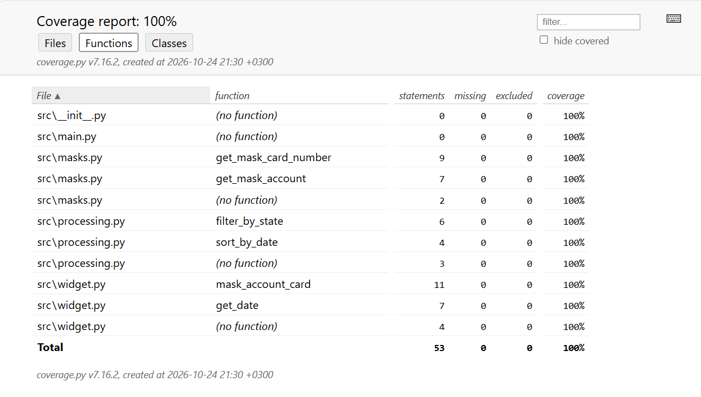

# 

   ## Учебный проект, создание виджетов для банковских операций клиента.
   ### Cтатус разработки - в разработке.
   

#### Задача: иметь сквозной проект на весь курс обучения, в котором по мере 
#### получения знаний и навыков, будут добовлятся функции банковских операций.

  

## Содержание
- [Модули ]()
- [Описание вложенных функций](#начало-работы)

### Модуль masks
- #### [Функция get_mask_card_number]()
  + Как работает эта функция:
   
Функция 
**get_mask_card_number**
 принимает на вход номер карты и возвращает ее маску. Номер карты замаскирован и отображается в формате 
XXXX XX** **** XXXX
, где 
X
 — это цифра номера. То есть видны первые 6 цифр и последние 4 цифры, остальные символы отображаются звездочками, номер разбит по блокам по 4 цифры, разделенным пробелами. Пример работы функции:
7000792289606361     # входной аргумент
7000 79** **** 6361  # выход функции

- #### [Функция get_mask_account]()
  + Как работает эта функция:
  
Функция 
**get_mask_account**
 принимает на вход номер счета и возвращает его маску. Номер счета замаскирован и отображается в формате 
**XXXX
, где 
X
 — это цифра номера. То есть видны только последние 4 цифры номера, а перед ними — две звездочки. Пример работы функции:
73654108430135874305  # входной аргумент
**4305  # выход функции

### Модуль widget
- #### [Функция mask_account_card]()
  + Как работает эта функция:

функцию 
**mask_account_card**
обрабатывать информацию как о картах, так и о счетах.
Функция должна:

Принимать один аргумент — строку, содержащую тип и номер карты или счета.
Аргументом является строка типа 
Visa Platinum 7000792289606361
, или 
Maestro 7000792289606361
, или 
Счет 73654108430135874305
Разделять строку на 2 аргумента (отдельно имя, отдельно номер) нельзя!

Функция возвращать строку с замаскированным номером. Для карт и счетов отрабатывается 
разные типы маскировки. 

Пример для карты
Visa Platinum 7000792289606361  # входной аргумент
Visa Platinum 7000 79** **** 6361  # выход функции

Пример для счета
Счет 73654108430135874305  # входной аргумент
Счет **4305  # выход функции

- #### [Функция get_date]()
  + Как работает эта функция:

Функция **get_date** принимает на вход строку с датой в формате 
"2024-03-11T02:26:18.671407"
 и возвращает строку с датой в формате 
"ДД.ММ.ГГГГ"

### Модуль processing
- #### [Функция filter_by_state]()
  + Как работает эта функция:
  
Функция **filter_by_state**, принимает список словарей и опционально значение для ключа
state (по умолчанию 'EXECUTED'). Функция возвращает новый список словарей, содержащий только
 те словари, у которых ключ state соответствует указанному значению.

- #### [Функция sort_by_date]()
  + Как работает эта функция:

Функция sort_by_date, принимает список словарей и необязательный параметр,
задающий порядок сортировки (по умолчанию — убывание). Функция возвращает новый 
список, отсортированный по дате (date).

### Установка зависимостей

Для установки зависимостей, выполните команду: **pip install -r requirements.txt**
 

## Использование

Полное использование проекта будет описано позднее, когда сам пойму.

## Тестирование

### test_get_mask_card_number ###

Использованы инструменты тестирования: 
+ **assert** 
+ **@pytest.mark.parametrize** - прямой ввод данных
+ **@pytest.mark.parametrize** - данные в виде аргумента - функция **card_numbers** из **conftest.py**

### test_get_mask_account ###

Использованы инструменты тестирования: 
+ **assert** 
+ **@pytest.mark.parametrize** - прямой ввод данных
+ **@pytest.mark.parametrize** - данные в виде аргумента - функция **account_numbers** из **conftest.py**

### test_mask_account_card ###

Использованы инструменты тестирования: 
+ **assert** 
+ **@pytest.mark.parametrize** - прямой ввод данных
+ **@pytest.mark.parametrize** - данные в виде аргумента - функция **account_card** из **conftest.py**

### test_get_date ###

Использованы инструменты тестирования: 
+ **assert** 
+ **@pytest.mark.parametrize** - прямой ввод данных
+ **@pytest.mark.parametrize** - данные в виде аргумента - функция **get_date_input** из **conftest.py**

### test_filter_by_state ###

Использованы инструменты тестирования: 
+ **@pytest.fixture()
def filter_by_state_input** 

### test_sort_by_date ###

Использованы инструменты тестирования:
+ **@pytest.fixture()**
def sort_by_date_input(request):
    return request.param

### Покрытие тестами

## Команда проекта

- [Виктор Гетьманов] — student

**Связаться со мной:**

- 📞️ [Номер телефона](tel:+79189814879): **+7 (918) 981-48-79**
- ✉️ [Электронная почта](mailto:palada1973@gmail.com): **palada1973@gmail.com**

## Источники

+ Учебный курс **Skypro**: **Python-разработчик**