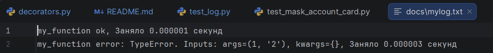
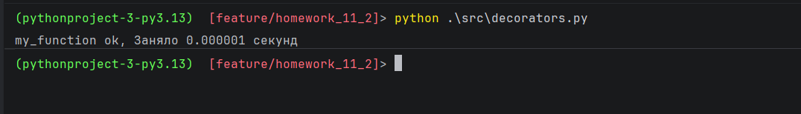
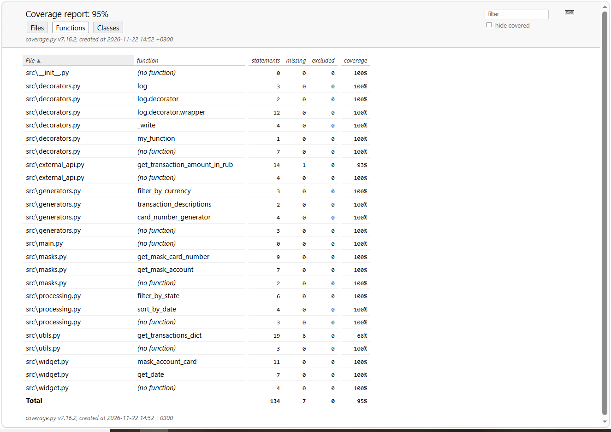

# 

   ## Учебный проект, создание виджетов для банковских операций клиента.
   ### Cтатус разработки - в разработке.
   

#### Задача: иметь сквозной проект на весь курс обучения, в котором по мере 
#### получения знаний и навыков, будут добовлятся функции банковских операций.


  

## Содержание
- [Модули ]()
- [Описание вложенных функций](#начало-работы)


### Модуль masks
- #### [Функция get_mask_card_number]()
  + Как работает эта функция:
   
Функция 
**get_mask_card_number**
 принимает на вход номер карты и возвращает ее маску. Номер карты замаскирован и отображается в формате 
XXXX XX** **** XXXX
, где 
X
 — это цифра номера. То есть видны первые 6 цифр и последние 4 цифры, остальные символы отображаются звездочками, номер разбит по блокам по 4 цифры, разделенным пробелами. Пример работы функции:
7000792289606361     # входной аргумент
7000 79** **** 6361  # выход функции


- #### [Функция get_mask_account]()
  + Как работает эта функция:
  
Функция 
**get_mask_account**
 принимает на вход номер счета и возвращает его маску. Номер счета замаскирован и отображается в формате 
**XXXX
, где 
X
 — это цифра номера. То есть видны только последние 4 цифры номера, а перед ними — две звездочки. Пример работы функции:
73654108430135874305  # входной аргумент
**4305  # выход функции


### Модуль widget
- #### [Функция mask_account_card]()
  + Как работает эта функция:

функцию 
**mask_account_card**
обрабатывать информацию как о картах, так и о счетах.
Функция должна:

Принимать один аргумент — строку, содержащую тип и номер карты или счета.
Аргументом является строка типа 
Visa Platinum 7000792289606361
, или 
Maestro 7000792289606361
, или 
Счет 73654108430135874305
Разделять строку на 2 аргумента (отдельно имя, отдельно номер) нельзя!

Функция возвращать строку с замаскированным номером. Для карт и счетов отрабатывается 
разные типы маскировки. 

Пример для карты
Visa Platinum 7000792289606361  # входной аргумент
Visa Platinum 7000 79** **** 6361  # выход функции

Пример для счета
Счет 73654108430135874305  # входной аргумент
Счет **4305  # выход функции


- #### [Функция get_date]()
  + Как работает эта функция:

Функция **get_date** принимает на вход строку с датой в формате 
"2024-03-11T02:26:18.671407"
 и возвращает строку с датой в формате 
"ДД.ММ.ГГГГ"


### Модуль processing
- #### [Функция filter_by_state]()
  + Как работает эта функция:
  
Функция **filter_by_state**, принимает список словарей и опционально значение для ключа
state (по умолчанию 'EXECUTED'). Функция возвращает новый список словарей, содержащий только
 те словари, у которых ключ state соответствует указанному значению.


- #### [Функция sort_by_date]()
  + Как работает эта функция:

Функция sort_by_date, принимает список словарей и необязательный параметр,
задающий порядок сортировки (по умолчанию — убывание). Функция возвращает новый 
список, отсортированный по дате (date).


### Модуль generators
- #### [filter_by_currency]()
  + Как работает эта функция:
Принимает на вход список словарей, представляющих транзакции.
Функция должна возвращать итератор, который поочередно выдает транзакции, 
где валюта операции соответствует заданной (например, USD).

- #### [transaction_descriptions]()
  + Как работает эта функция:
генератор, который принимает список словарей с транзакциями и возвращает 
описание каждой операции по очереди.

Пример использования функции
descriptions = transaction_descriptions(transactions)
for _ in range(5):
    print(next(descriptions))

```
 Перевод организации 
 Перевод со счета на счет
 Перевод со счета на счет
 Перевод с карты на карту
 Перевод организации
```
 

- #### [card_number_generator]()
  + Как работает эта функция:

генератор, который выдает номера банковских карт в формате XXXX XXXX XXXX XXXX
X — цифра номера карты. Генератор может сгенерировать номера карт в заданном диапазоне 
от 0000 0000 0000 0001 до 9999 9999 9999 9999.
Генератор должен принимать начальное и конечное значения для генерации диапазона номеров.

Пример использования функции
for card_number in card_number_generator(1, 5):
    print(card_number)

```
0000 0000 0000 0001
0000 0000 0000 0002
0000 0000 0000 0003
0000 0000 0000 0004
0000 0000 0000 0005
```
 

### Модуль decorators
- #### [Функция log]()
  + Как работает эта функция:
   
Функция 
**log**
Автоматически логирует начало и конец выполнения функции,
а также ее результаты или возникшие ошибки.
Декоратор должен принимать необязательный аргумент
filename
, который определяет, куда будут записываться логи (в файл или в консоль):

Если
filename
 задан, логи записываются в указанный файл.
Если
filename
 не задан, логи выводятся в консоль.
Логирование должно включать:

Имя функции и результат выполнения при успешной операции.
Имя функции, тип возникшей ошибки и входные параметры, если выполнение функции привело к ошибке.
Примеры вывода:






### Модуль utils
- #### [Функция get_transactions_dict]()
  + Как работает эта функция:
   
Функция 
**get_transactions_dict**

Загружает список транзакций из JSON-файла.

    Возвращает пустой список, если:
    - файл не найден;
    - файл пустой;
    - содержимое не является списком;
    - JSON некорректен.

    Args:
        input_file: имя файла в директории data/
        base_dir: опциональный путь к корню проекта (для тестов)

    Returns:
        list[dict]: список транзакций или [] при ошибке


### Модуль external_api
**Функция `get_transaction_amount_in_rub`**
  + Как работает эта функция:
   
Функция 
**get_transaction_a]()mount_in_rub**

```python
Принимает транзакцию и возвращает сумму в рублях.
Для USD/EUR запрашивает курс через Exchange Rates Data API.
```


### Установка зависимостей

Для установки зависимостей, выполните команду: **pip install -r requirements.txt**
 


## Использование

Полное использование проекта будет описано позднее, когда сам пойму.


## Тестирование

### test_get_mask_card_number ###

Использованы инструменты тестирования: 
+ **assert** 
+ **@pytest.mark.parametrize** - прямой ввод данных
+ **@pytest.mark.parametrize** - данные в виде аргумента - функция **card_numbers** из **conftest.py**


### test_get_mask_account ###

Использованы инструменты тестирования: 
+ **assert** 
+ **@pytest.mark.parametrize** - прямой ввод данных
+ **@pytest.mark.parametrize** - данные в виде аргумента - функция **account_numbers** из **conftest.py**


### test_mask_account_card ###

Использованы инструменты тестирования: 
+ **assert** 
+ **@pytest.mark.parametrize** - прямой ввод данных
+ **@pytest.mark.parametrize** - данные в виде аргумента - функция **account_card** из **conftest.py**


### test_get_date ###

Использованы инструменты тестирования: 
+ **assert** 
+ **@pytest.mark.parametrize** - прямой ввод данных
+ **@pytest.mark.parametrize** - данные в виде аргумента - функция **get_date_input** из **conftest.py**


### test_filter_by_state ###

Использованы инструменты тестирования: 
+ **@pytest.fixture()
def filter_by_state_input** 


### test_sort_by_date ###

Использованы инструменты тестирования:
+ **@pytest.mark.parametrize()**
def sort_by_date_input(request):
    return request.param

### `test_filter_by_currency`

💡 Использованы инструменты тестирования: `@pytest.fixture`.

* **Фикстура `transactions()`**: подготавливает тестовые данные.
* **`test_usd_returns_two_transactions(transactions)`**: `currency='USD'` -> ровно 2 транзакции с id 939719570 и 142264268.
* **`test_rub_returns_one_transaction(transactions)`**: `currency='RUB'` -> ровно 1 транзакция с id 873106923.
* **`test_eur_returns_empty_iterator(transactions)`**: `currency='EUR'` -> пустой итератор, `next()` -> `StopIteration`.


### `test_transaction_descriptions`

💡 Использованы инструменты тестирования: `@pytest.fixture`.

* **Фикстура `transactions()`**: подготавливает тестовые данные.
* **`test_returns_descriptions_in_order(transactions)`**: выдаёт описания всех транзакций по порядку.
* **`test_returns_iterator(transactions)`**: возвращает именно итератор, а не список.
* **`test_empty_input()`**: для пустого списка итератор сразу исчерпан.


### `test_card_number_generator`

💡 Использованы инструменты тестирования: `@pytest.mark.parametrize("start, end, expected")`.

* **`test_returns_number_card(start, end, expected)`**: проверяет, что генератор возвращает номера карт в ожидаемом формате и порядке с помощью `assert list(card_number_generator(start, end)) == expected`.


### `test_log`

💡 Использованы инструменты тестирования: `assert`.

* **`def test_log_success_to_console(capsys):`**: Успех: логирует в консоль..
* **`def test_log_success_to_file(tmp_path):`**: Успех: логирует в файл..
* **`def test_log_error_to_console(capsys):`**: Ошибка: логирует и пробрасывает исключение.
* **`def test_log_error_to_file(tmp_path):`**: Ошибка: пишет в файл и пробрасывает исключение.


### `test_utils`

💡 Использованы инструменты тестирования: `assert`.

* **`def test_missing_file_returns_empty_list(tmp_path):`**: Ошибка: файла нет → пустой список..
* **`def test_loads_valid_transactions(tmp_path):`**: Успех: Корректный JSON со списком транзакций → возвращается этот список..
* **`def test_not_a_list_returns_empty_list(tmp_path):`**: Ошибка: В JSON лежит объект, а не список → пустой список.


## `test_external_api`

💡 Использованы инструменты тестирования: `assert`.

* **`def test_rub_transaction_returns_amount():`**: Успех: Если валюта RUB, API не вызывается, возвращается просто amount.
* **`def test_usd_transaction_uses_api(mock_get, mock_getenv):`**: Успех: Если валюта USD, вызывается API (подменяем через Mock).
* **`def test_eur_transaction_uses_api(mock_get, mock_getenv):`**: Успех: Если валюта EUR, тоже идет запрос к API.


### Покрытие тестами



## Команда проекта


- [Виктор Гетьманов] — student


**Связаться со мной:**

- 📞️ [Номер телефона](tel:+79189814879): **+7 (918) 981-48-79**
- ✉️ [Электронная почта](mailto:palada1973@gmail.com): **palada1973@gmail.com**


## Источники

+ Учебный курс **Skypro**: **Python-разработчик**

## Лицензия и товарные знаки

Код проекта распространяется под лицензией MIT.

Логотип и товарный знак Skypro принадлежат ООО «Скайпро» и используются
в этом репозитории исключительно в информационных целях как указание
на образовательную программу, в рамках которой выполнен проект.